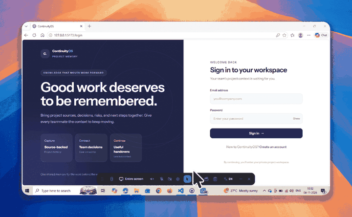

# ContinuityOS

ContinuityOS is an evidence-driven project knowledge and handover platform. It turns project documents into reviewable claims linked to source evidence, then helps teams reconstruct project status and prepare a human-approved handover.



*Animated product walkthrough. The original recording is optimized here for inline display in the GitHub README.*

## Live demo

**[Open ContinuityOS](https://continuityos-web.onrender.com)**


## Features

- Create project workspaces and invite project members with contributor or reviewer roles.
- Upload and preview TXT, Markdown, CSV, JSON, PDF, and DOCX sources (up to 10 MB per file).
- Extract candidate decisions, tasks, risks, blockers, dependencies, questions, and milestones with source excerpts.
- Review claims, preserve corrections and review history, and inspect potential conflicts or stale information.
- Reconstruct project knowledge from reviewed claims while respecting private-source access.
- Draft and approve evidence-backed handovers, share approved reports with registered accounts, and export reports as PDF.
- Authenticate with JWTs and persist logout revocations.

## Technology

- **Frontend:** React 18, TypeScript, Vite, Tailwind CSS, React Router
- **Backend:** Python, FastAPI, Pydantic, SQLAlchemy
- **Database:** PostgreSQL for Docker Compose; SQLite is suitable for local development and tests
- **Migrations:** Alembic
- **Documents:** PyPDF, python-docx, ReportLab
- **Optional AI extraction:** OpenAI or Anthropic; without provider credentials, the app uses an explicitly limited rule-based candidate finder

## Run locally (Windows PowerShell)

Prerequisites: Python 3.11+, Node.js 18+, and npm.

Create the virtual environment and install backend dependencies from the repository root:

```powershell
python -m venv .venv
.\.venv\Scripts\python.exe -m pip install -r backend\requirements.txt
```

In the first terminal, start the backend with a local SQLite database:

```powershell
Set-Location backend
$env:DATABASE_URL = "sqlite:///./.runtime.db"
$env:SECRET_KEY = "local-development-secret"
..\.venv\Scripts\python.exe -m alembic upgrade head
..\.venv\Scripts\python.exe -m uvicorn app.main:app --reload
```

In a second terminal, start the frontend:

```powershell
Set-Location frontend
npm ci
npm run dev
```

Open [http://localhost:5173](http://localhost:5173). The backend runs at [http://localhost:8000](http://localhost:8000), with interactive API docs at [http://localhost:8000/docs](http://localhost:8000/docs) and a database-aware health check at [http://localhost:8000/api/v1/health](http://localhost:8000/api/v1/health).

## Seeded walkthrough

To load the showcase data:

1. Register the owner email configured as `OWNER_EMAIL` in `backend/scripts/seed_demo.py`.
2. In a backend terminal with the same `DATABASE_URL` and `SECRET_KEY`, run:

   ```powershell
   ..\.venv\Scripts\python.exe -m scripts.seed_demo
   ```

The idempotent seeder adds three portfolio sample workspaces and the fictional **ContinuityOS Reviewer Walkthrough** project. The walkthrough demonstrates contradictory retention statements, an outdated milestone, an unassigned task, and private-source filtering. Seeded collaborators are examples, not demo sign-in accounts; their passwords are randomly generated. The seeder does not set or change the owner's password.

## Tests

Run the backend integration and parser tests from `backend` using a separate SQLite database:

```powershell
$env:DATABASE_URL = "sqlite:///../continuityos-tests.db"
..\.venv\Scripts\python.exe -m pytest -q -p no:cacheprovider --basetemp=../.pytest-tmp
```

Build the frontend from `frontend`:

```powershell
npm run build
```

## Docker Compose

Docker Compose runs PostgreSQL, the API, and a production-built Nginx frontend. From the repository root, create a root `.env` from `.env.example`, set unique `SECRET_KEY` and `POSTGRES_PASSWORD` values, then run:

```powershell
docker compose up --build
```

The app is then available at [http://localhost:5173](http://localhost:5173). Compose uses local persistent volumes for PostgreSQL and uploaded files; it is not a cloud deployment.

## Configuration and limitations

- Local backend settings can be supplied as environment variables or in `backend/.env`. The frontend API URL can be set with `VITE_API_BASE_URL`; it defaults to `http://localhost:8000`.
- Optional AI extraction uses `LLM_PROVIDER`, `OPENAI_API_KEY` / `OPENAI_MODEL`, or `ANTHROPIC_API_KEY` / `ANTHROPIC_MODEL`. Never commit provider keys or production secrets.
- Generated claims remain unverified until human review. Conflict and staleness detection are heuristic prompts for review, not automatic judgments about which claim is correct.
- Scanned-image OCR, password-protected PDFs, PDFs over 500 pages, and DOCX archives expanding beyond 50 MB are unsupported.
- The hosted app is a free-tier demo, not a production deployment. Durable object storage, email delivery, password reset, and asynchronous processing are not included.
